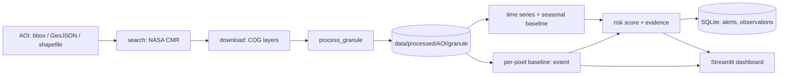
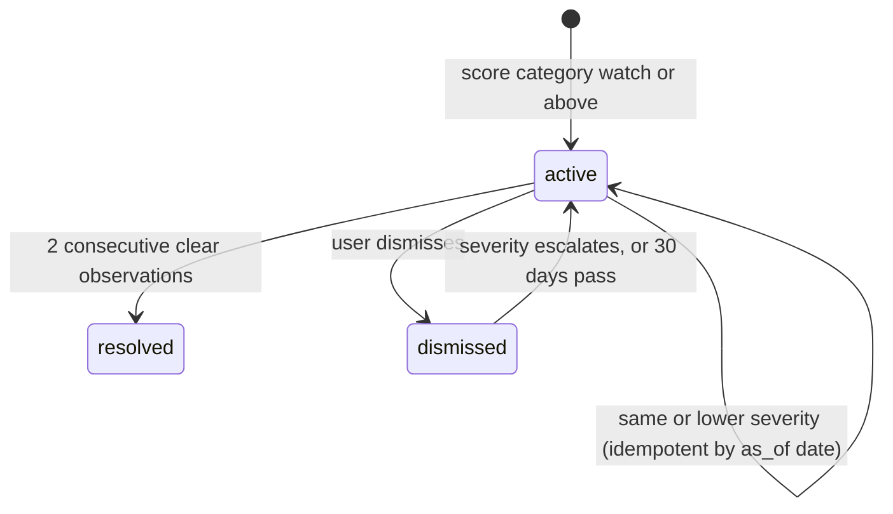

# Architecture

## Data flow

`process_granule` order: read the AOI window, verify all layers share one grid, scale reflectance (fill to NaN), decode Fmask,
mask, compute indices, summarise, write GeoTIFFs plus `summary.json` with provenance.

## Design rules
1. **Logic lives in `src/`.** Dashboard pages only present results, so everything is testable without a browser.
2. **Configuration, not constants.** Sensor facts are in `configs/sensors.yaml`, thresholds in `configs/thresholds.yaml`
   (`validated: false`), runtime settings in `configs/default.yaml`; a gitignored `configs/local.yaml` can override them.
3. **Providers are replaceable.** `src/data/providers/base.py` defines the interface; only NASA HLS is implemented.
4. **Rasters stay on disk, metadata in SQLite.** The database holds AOIs, granules, observations, summaries, jobs, alerts,
   alert events, model versions and evaluation runs, with numbered migrations.
5. **Real and demo never mix.** The dashboard has one mode switch; demo data are generated in `src/utils/demo_data.py` and always bannered.
6. **Fail loudly and honestly.** Missing history yields "insufficient baseline/data", not a guessed number.

## Storage schema (SQLite, WAL mode)
`aois`, `granules`, `observations`, `index_summaries`, `processing_jobs`, `alerts`, `alert_events`, `model_versions`,
`evaluation_runs`, `schema_version`. A partial unique index allows only one active alert per (AOI, kind).

## Alert lifecycle

Observations with insufficient data or baseline never change alert state.

## Not built
REST API, container image, scheduled jobs, additional sensors. See [DEPLOYMENT.md](DEPLOYMENT.md) for the current run options.
